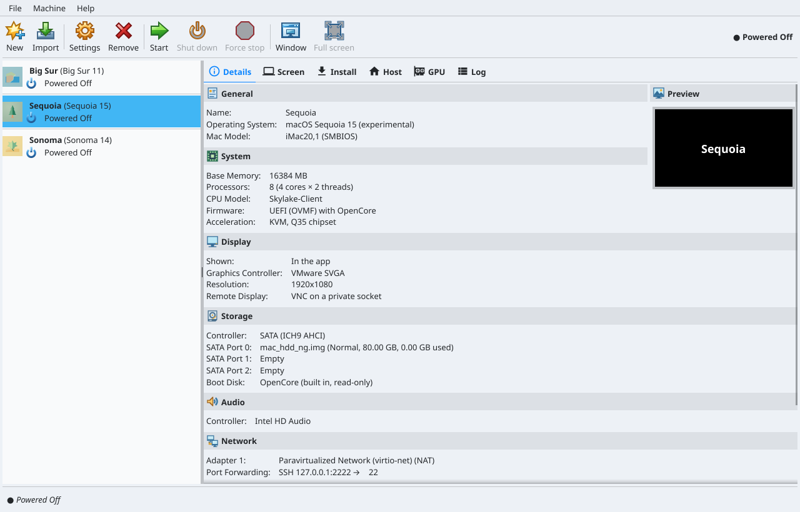

<p align="center">
  
</p>

<h1 align="center">macOS KVM</h1>

<p align="center">
  <b>Run macOS on Linux with KVM, from a single desktop app.</b><br>
  Download, install and boot macOS in a few clicks: OpenCore and OVMF are built in, nothing else to clone or script.
</p>

<p align="center">
  <a href="https://github.com/jniltinho/macos-kvm-gui/actions/workflows/ci.yml"></a>
  <a href="https://github.com/jniltinho/macos-kvm-gui/actions/workflows/release.yml"></a>
  <a href="https://github.com/jniltinho/macos-kvm-gui/releases/latest"></a>
  <a href="https://github.com/jniltinho/macos-kvm-gui/releases"></a>
  <a href="https://go.dev/"></a>
  <a href="LICENSE"></a>
  <a href="https://github.com/jniltinho/macos-kvm-gui/stargazers"></a>
</p>

<p align="center">
  
</p>

<p align="center">
  <b><a href="https://github.com/jniltinho/macos-kvm-gui/releases/latest">⬇ Download the latest release</a></b>
</p>

> **For home lab use.** macOS is Apple's software, and its license only allows it on Apple-branded hardware. Make sure your use complies with Apple's macOS license terms. This project is not affiliated with Apple.

## Highlights

- **One binary.** OpenCore, Lilu, VirtualSMC, WhateverGreen and OVMF are embedded; no `git`, `python3` or OSX-KVM clone.
- **Verified downloads.** The recovery comes from Apple, checked against Apple's signature and every chunk's SHA-256.
- **Several VMs, VirtualBox style.** A New VM wizard, one folder per VM in the Workspace, export/import, and macOS on screen inside the app.
- **Scriptable.** The same binary is a [command line tool](docs/cli.md).

Sonoma 14 is validated end to end; High Sierra through Tahoe are experimental. More in the [overview](docs/overview.md).

## Quick start

```sh
sudo apt install ./macos-kvm-gui_*_amd64.deb      # Ubuntu 24.04+, Debian 13+
sudo dnf install ./macos-kvm-gui-*.x86_64.rpm     # Fedora 39+
```

Both add "macOS KVM" to the applications menu. Needs Linux x86_64 with glibc 2.38+, VT-x/AMD-V, `qemu-system-x86`, `qemu-utils` and `pkexec`. Then open **macOS KVM**, make the **Host** checks green, click **New**, and **Start**. Inside the VM, erase the disk as APFS in Disk Utility and run **Reinstall macOS**. Full walkthrough: [getting started](docs/getting-started.md).

## Documentation

[Overview](docs/overview.md) · [Getting started](docs/getting-started.md) · [Command line](docs/cli.md) · [Architecture](docs/architecture.md) · [GPU passthrough](docs/gpu-passthrough.md) · [Troubleshooting](docs/troubleshooting.md) · [Development](docs/development.md) · [Screenshots](docs/screenshots/README.md) · [References](docs/references.md)

## Build

```sh
make build   # dist/macos-kvm-gui (Go 1.27+, Fyne build deps: see docs/development.md)
make test
```

## License

BSD-3-Clause ([LICENSE](LICENSE)). The embedded boot files keep their own licenses ([THIRD_PARTY_NOTICES.md](THIRD_PARTY_NOTICES.md)). Built on the work of [OSX-KVM](https://github.com/kholia/OSX-KVM), [acidanthera](https://github.com/acidanthera), [TianoCore](https://github.com/tianocore/edk2), [Dortania](https://dortania.github.io/) and [Fyne](https://fyne.io); see [references](docs/references.md).
