# Documentation

macos-kvm-gui is a Go + Fyne desktop app for installing and running macOS on Linux KVM/QEMU, with embedded OpenCore and OVMF.

**For home lab use.** Check [Apple's macOS license terms](https://www.apple.com/legal/sla/), including the Apple-branded-hardware restrictions. This project is not affiliated with Apple. Only Sonoma has been validated end to end; GPU passthrough is **untested on real hardware**.

## Guides

- [Overview](overview.md): features, how it works, macOS support and how it compares with OSX-KVM.
- [Getting started](getting-started.md): requirements, release installation (`.deb`, `.rpm`, `.tar.gz`), the New VM wizard, the tabs and installing macOS.
- [Architecture](architecture.md): packages, VM lifecycle, workspace, recovery and asset overrides.
- [GPU passthrough](gpu-passthrough.md): compatibility, reservation, safeguards and recovery.
- [Troubleshooting](troubleshooting.md): exact app messages, fixes, network adapters and bridged networking, and display limitations.
- [Command line](cli.md): every step from a terminal, and an automated install script.
- [Development](development.md): builds, tests, boot assets, OpenSpec, CI and releases.
- [References](references.md): upstream projects and technical documentation.

See also the repository [README](../README.md), [license](../LICENSE) and [third-party notices](../THIRD_PARTY_NOTICES.md).

## Diagrams

The previews link to the self-contained SVG sources. PNG previews are generated from those SVGs.

### Architecture

[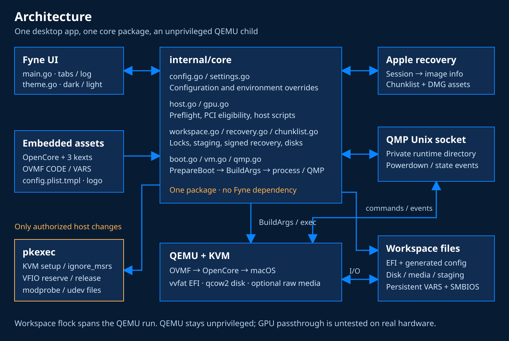](diagrams/architecture.svg)

### Boot flow

[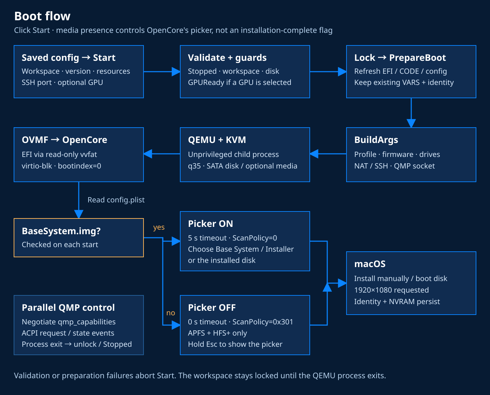](diagrams/boot-flow.svg)

### Installation journey

[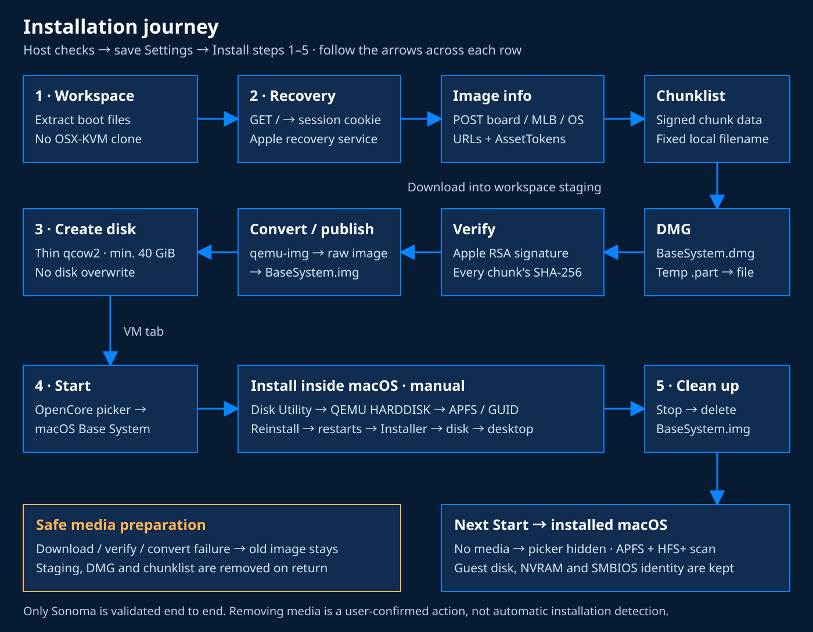](diagrams/install-flow.svg)

### Boot assets pipeline

[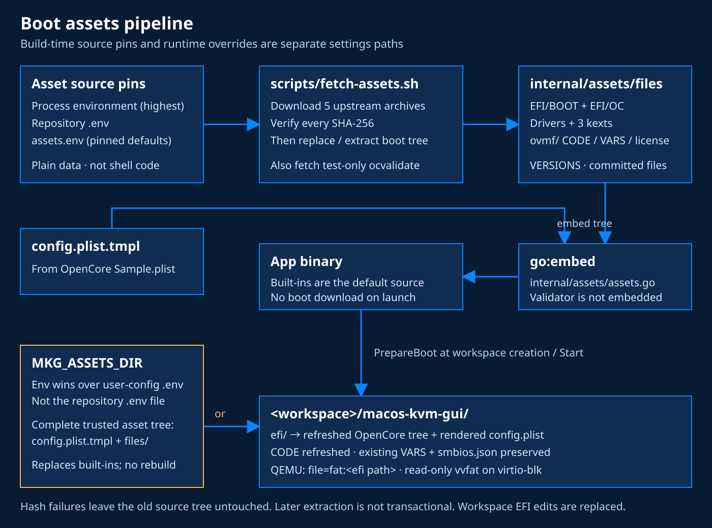](diagrams/assets-pipeline.svg)

### GPU passthrough

[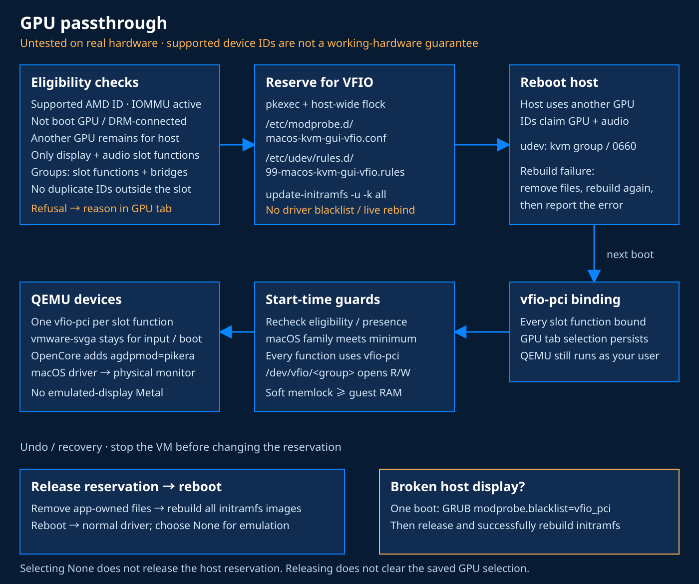](diagrams/gpu-passthrough.svg)

## Screenshots

Captions for each screen are in [screenshots/README.md](screenshots/README.md).

### Details

### New VM wizard

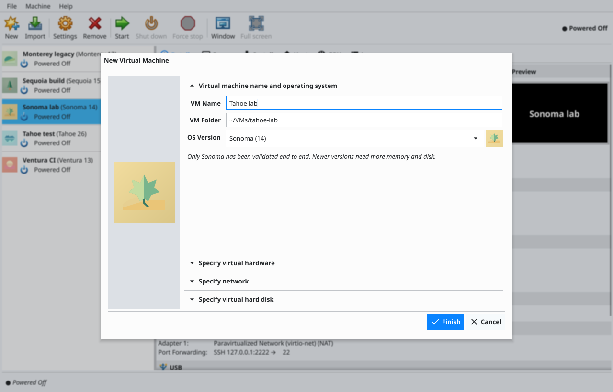

### Install

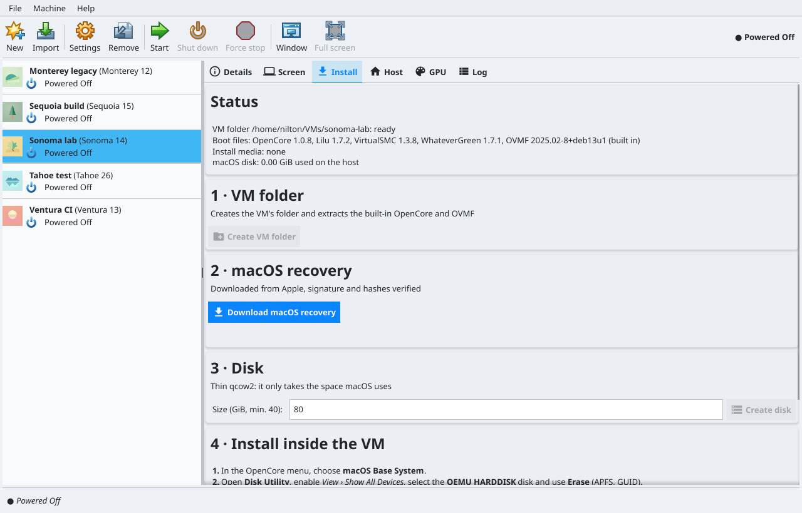

### Settings

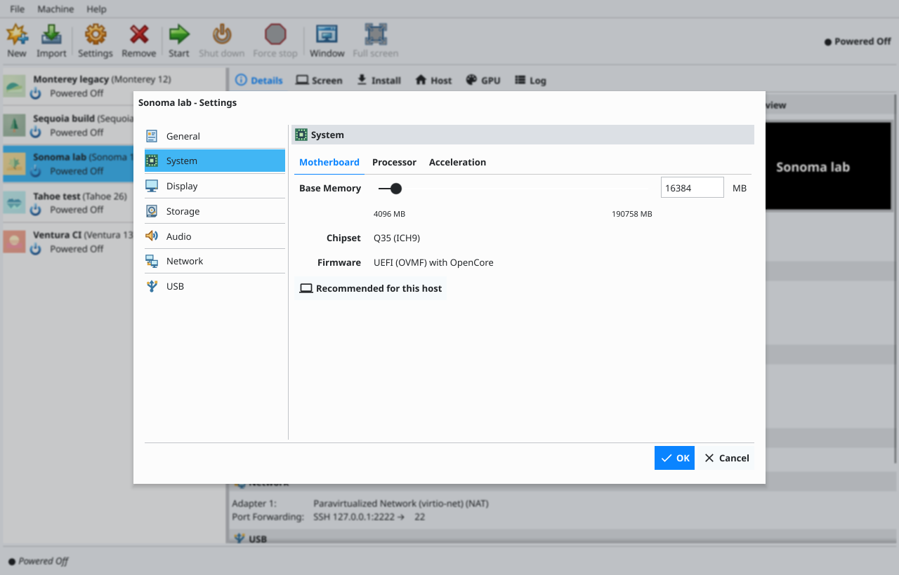

### Host

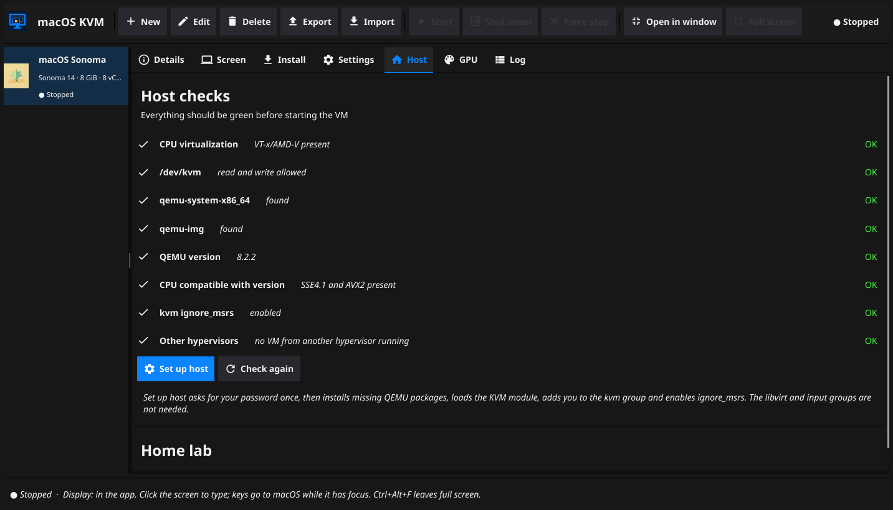

### GPU

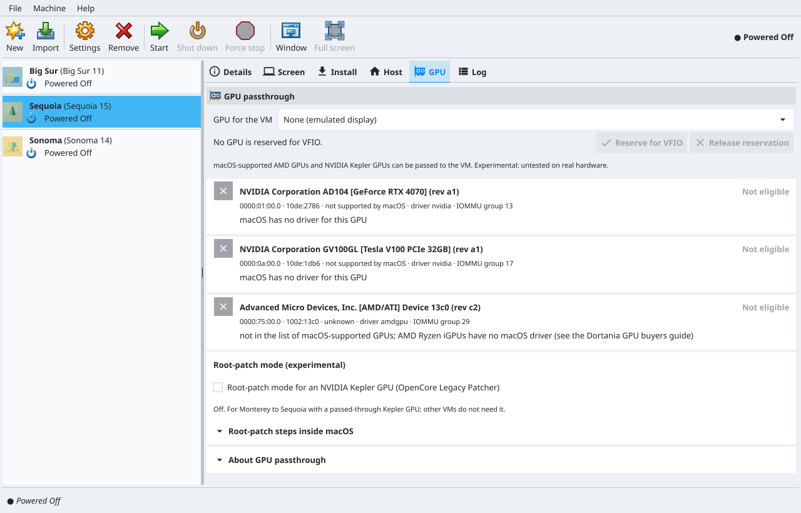

### Log

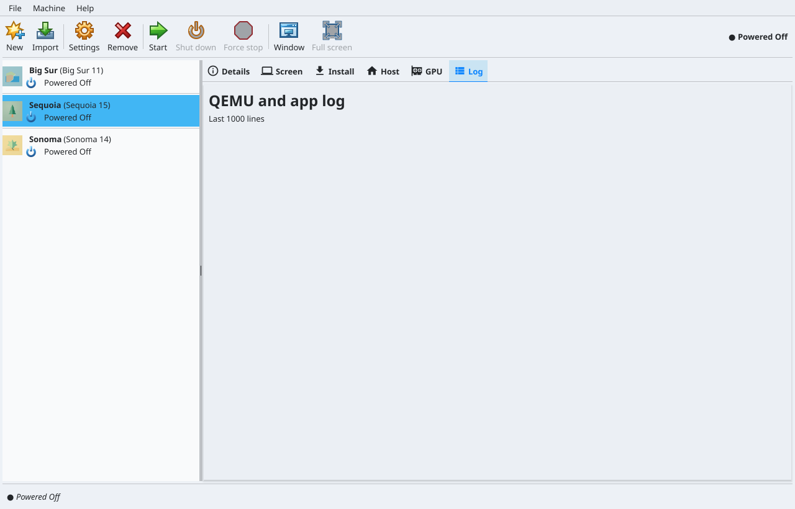
