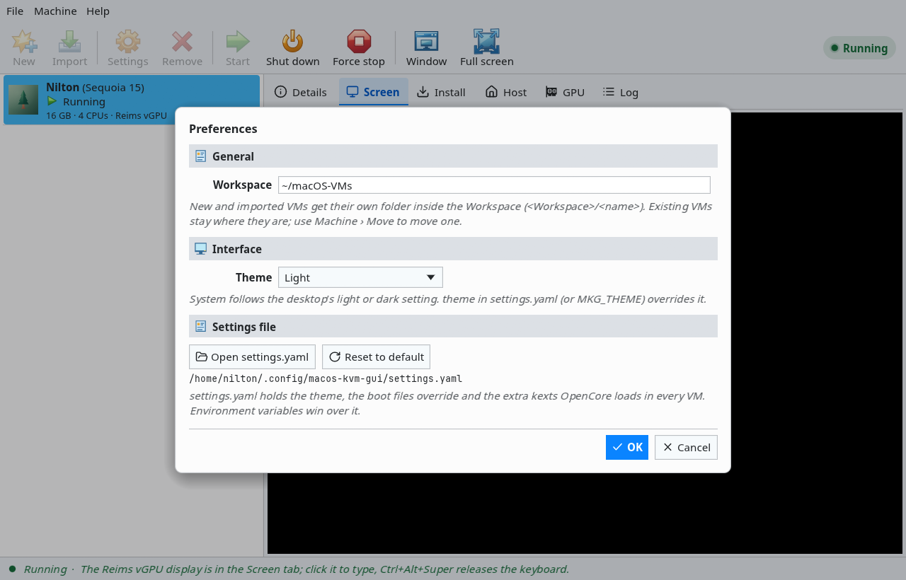

# reims-gui

[Documentation index](README.md)

**Preview.** `reims-gui` is the Rust rewrite of this app, focused on [Reims vGPU](reims-vgpu.md) and on Ubuntu 24.04 and 26.04. It has the same features, reads the same data and has the same command line and MCP server as `macos-kvm-gui`, in one binary. Its main addition is **the Reims vGPU display inside the app's window**. Some GUI pieces are still being finished; [reims-gui/PARITY.md](../reims-gui/PARITY.md) lists every feature and its state. Install, build and license: [reims-gui/README.md](../reims-gui/README.md).

## Install

Take the package for your Ubuntu release from the [Releases](https://github.com/jniltinho/macos-kvm-gui/releases) tagged `reims-gui-v*`:

```sh
sudo apt install ./reims-gui_<version>_ubuntu24.04_amd64.deb   # or ubuntu26.04 on 26.04
```

Then, in the **Host** tab: **Set up host** (one password prompt), then **Install Reims vGPU**, then **Check again**. Requirements and host settings are those of [Reims vGPU](reims-vgpu.md#requirements).

## Reims vGPU inside the window


*macOS Sequoia 15.8.1 on Reims vGPU (RTX 4070), drawn by the GPU inside the Screen tab; the login was typed in the tab.*

The Go app leaves a Reims VM's screen in Reims vGPU's own window ([The screen](reims-vgpu.md#the-screen)). `reims-gui` places that same window inside its **Screen** tab:

- **The GPU still draws it.** The guest is rendered by the library on the host's GPU in QEMU's process, exactly as in its own window. Nothing is copied through VNC, so the frame rate stays that of the standalone window (the release gate is at least 90% of it).
- **X11 embedding.** QEMU's window is created on X11 and moved (reparented) into the app's window, over the Screen tab's rectangle. On a Wayland desktop this goes through XWayland, which both Ubuntu releases run in their GNOME sessions.
- **Size.** The window follows the tab, in physical pixels on HiDPI screens. When macOS changes its display mode, the library scales the guest to the tab; the window is never resized outside the app.
- **Keyboard and pointer.** Click the guest to give it the keyboard. Keys go to QEMU as raw scancodes, so the guest's layout applies (ABNT2, ISO keys and the keypad included). **Ctrl+Alt+Super** releases the keyboard, as in the standalone window.
- **Dialogs and menus.** While a menu, dialog or popup covers the Screen tab, the guest is hidden, so clicks on the dialog never reach macOS. Switching to another tab or minimizing hides it too.
- **Restart.** When the VM stops, its window goes with QEMU; the next start embeds the new one.
- **Fallback.** When the app has no X11 connection, or QEMU's window is not found within 30 seconds or cannot be moved, the window stays on its own on the desktop and the Screen tab says so. Everything else works as usual.

The **Preview** in Details, `screen_capture` and the MCP input tools keep using the VM's private sockets, as in the Go app.

### VMware SVGA VMs

VMs on VMware SVGA with **Display: In the app** embed QEMU's own GTK window (`-display gtk`, no tabs or menu bar, zoom to fit) in the Screen tab over X11, like Reims VMs: keys reach the guest as native scancodes (keypad, ISO and JIS keys included), click the screen to type. QEMU's VNC socket stays on for the Preview and MCP. Without X11 the Screen tab draws the VNC socket instead (keys egui merges, such as keypad Enter, cannot be told apart there). QEMU's SDL display was tried first and dropped: it withdraws its window when the VM has no text consoles. **Display: QEMU window** keeps QEMU's window on the desktop.

### Dialogs over the screen



## Differences from the Go app

| | `macos-kvm-gui` (Go) | `reims-gui` (Rust) |
| --- | --- | --- |
| Reims vGPU screen | Reims vGPU's own window | Inside the Screen tab (X11/XWayland), own window as fallback |
| VMware SVGA screen | QEMU's GTK window embedded | VNC drawn by the app |
| New Sequoia and Tahoe VMs | Reims vGPU when installed and the host checks pass | The same |
| MCP input | Over the VM's VNC socket | Over the VM's QMP control socket, so a VM in QEMU's own window can be driven too |
| Switching VMs | Blocked while the current VM runs | Allowed: other VMs can be selected while one runs |
| Packages | `.deb`, `.rpm`, `.tar.gz` | `.deb` and `.tar.gz` for Ubuntu 24.04 and 26.04 only |
| Build | Go toolchain | Docker only |
| License | BSD-3-Clause | Source GPL-2.0-or-later OR LGPL-3.0-or-later; binaries GPL-3.0-or-later |
| Command name | `macos-kvm-gui` | `reims-gui` (same commands, flags and output) |

Both apps use the same VM list (`~/.config/macos-kvm-gui/macos-kvm-gui.db`), `settings.yaml` and Workspace, and can run at the same time: each shows the VMs the other started, can shut them down and refuses to start one that is already running. A VM created in one opens in the other with its disk, NVRAM, identity and settings.

## Troubleshooting

### The Screen tab says the display is in its own window

Embedding needs an X11 connection. Check:

```sh
echo "$XDG_SESSION_TYPE $DISPLAY $WAYLAND_DISPLAY"
```

- **No `DISPLAY`** (a Wayland session without XWayland): embedding is off; the Reims window opens on its own with SDL's native backend. Install or enable XWayland (Ubuntu's GNOME has it), log in again.
- **`DISPLAY` and `WAYLAND_DISPLAY` both set**, and the app still runs as a native Wayland window: start it through XWayland with `env -u WAYLAND_DISPLAY reims-gui`.
- **SSH or a container without the desktop's X server:** run the app in the desktop session.

### QEMU's window was not found

The Log tab shows `no Reims window for pid <pid> within 30s` (or `QEMU window` for VMware SVGA). The app looks for a window whose `_NET_WM_PID` is QEMU's process and whose title starts with `Reims vGPU` (or `QEMU`). Check what QEMU opened:

```sh
xwininfo -root -tree | grep -iE 'reims vgpu|qemu'
xprop _NET_WM_PID WM_NAME     # then click the window
```

- No window at all: QEMU failed or is still loading; read the Log tab and [Reims vGPU troubleshooting](troubleshooting.md#reims-vgpu).
- A window on the desktop with another PID: QEMU was started outside the app (`vm start`, the Go app, the MCP server). Only VMs started from this window are embedded; the others keep their own window.
- The window opened on Wayland, not X11: QEMU gets `SDL_VIDEO_DRIVER=x11` (Reims) or `GDK_BACKEND=x11` (VMware SVGA) only when the app itself runs on X11; see the previous section.
- VMware SVGA: QEMU's GTK display comes from the `qemu-system-gui` package (a dependency of the `.deb`); with the `.tar.gz`, install it.

### Closing the app with a VM on screen

Quit, SIGTERM, SIGINT (Ctrl+C) and SIGHUP put QEMU's window back on the desktop before the app exits, and QEMU stops with the app. If the app is killed (SIGKILL) or crashes while a VM is on screen, the X server moves QEMU's window itself; on Ubuntu 26.04's GNOME Wayland session, Xwayland 24.1 crashes doing that (an upstream bug), taking the session's X11 windows with it. Avoid `kill -9` on the app while a VM runs.

### Keyboard or focus

- Keys do nothing: click inside the guest first; the app gives QEMU's window the input focus on click.
- GNOME's shortcuts (Super, Alt+Tab, Alt+F2) act on the desktop even while the guest has the keyboard: GNOME on Wayland does not let XWayland applications grab the keyboard unless allowed (`gsettings set org.gnome.mutter.wayland xwayland-allow-grabs true`, plus an entry in `xwayland-grab-access-rules`), and it applies to Reims vGPU's own window too. Measured in a headless GNOME Shell 46 and 50; a logged-in session, where GNOME may ask to let the app inhibit its shortcuts, is still to be checked.
- A dialog is open: the guest is hidden and gets no input until it closes.
- Brazilian ABNT2: the `/?` key next to right Shift types nothing in macOS's Brazilian ABNT2 layout (the key reaches the guest; macOS gives it nothing, as with an ABNT2 USB keyboard on a Mac). Type `/` with Option+Q (AltGr+Q) and `?` with Option+W.

### Diagnostics

`RG_DEBUG=1 reims-gui` traces the embedding (`[embed]`, `[rg-x11]`) and echoes QEMU's output (`[vm]`) on stderr; with `REIMS_VGPU_STATS=1` that includes Reims vGPU's frame statistics once a second.

### Docker build

- `permission denied ... /var/run/docker.sock`: add yourself to the `docker` group (`sudo usermod -aG docker "$USER"`) and log in again, or use rootless Docker.
- The first `scripts/cargo-docker.sh` or `scripts/build.sh` run builds the `reims-gui-build:<release>` image; it needs network access. Every run goes through `docker build`, so the image follows changes to `reims-gui/docker/Dockerfile` (cached, it takes a fraction of a second).
- Builds go to `reims-gui/target/`, owned by your user. If a run as root left files there, `sudo chown -R "$USER": reims-gui/target`.
- Always build packages with `scripts/build.sh <release>`: a binary built in the 24.04 image may not run on 26.04 and the reverse.

### Packages

- `apt` cannot resolve dependencies: the package is for the other Ubuntu release (`ubuntu24.04` vs `ubuntu26.04` in the file name).
- The window does not open on a machine without a GPU driver: install `mesa-vulkan-drivers` (software Vulkan); `reims-gui --self-test` draws a few frames and exits 0 when the window works.
- `scripts/check-package.sh <release>` installs the built `.deb` in a clean `ubuntu:<release>` container and runs `--self-test` under Xvfb; run it before publishing.
- `scripts/check-gnome.sh <release>` runs GNOME's compositor (Mutter, headless, Wayland + XWayland) in a clean container with the `.deb` and `/dev/kvm`: self-tests on XWayland and Wayland, a VMware SVGA VM's QEMU window embedded in the Screen tab, and SIGTERM releasing it with Xwayland still up.

For messages shared with the Go app (KVM, disks, recovery, network, GPU), see [Troubleshooting](troubleshooting.md).
