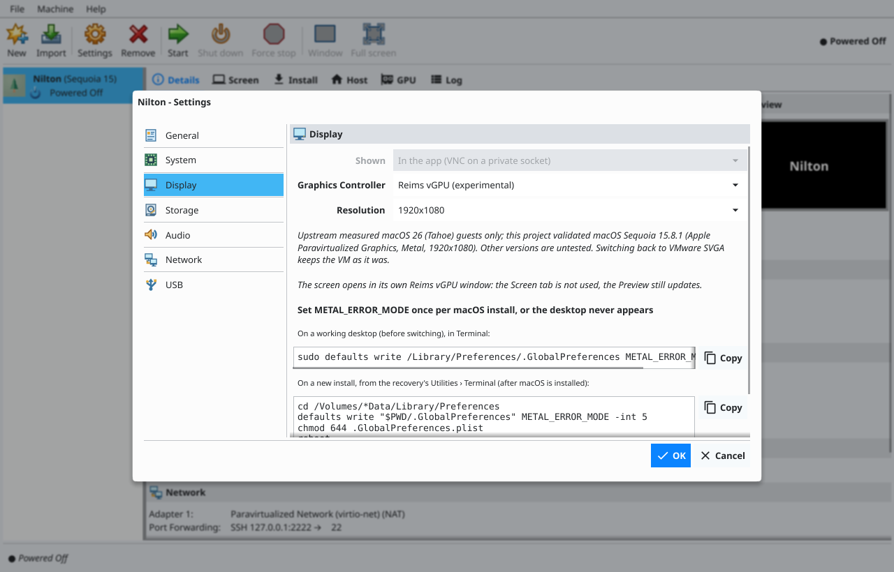
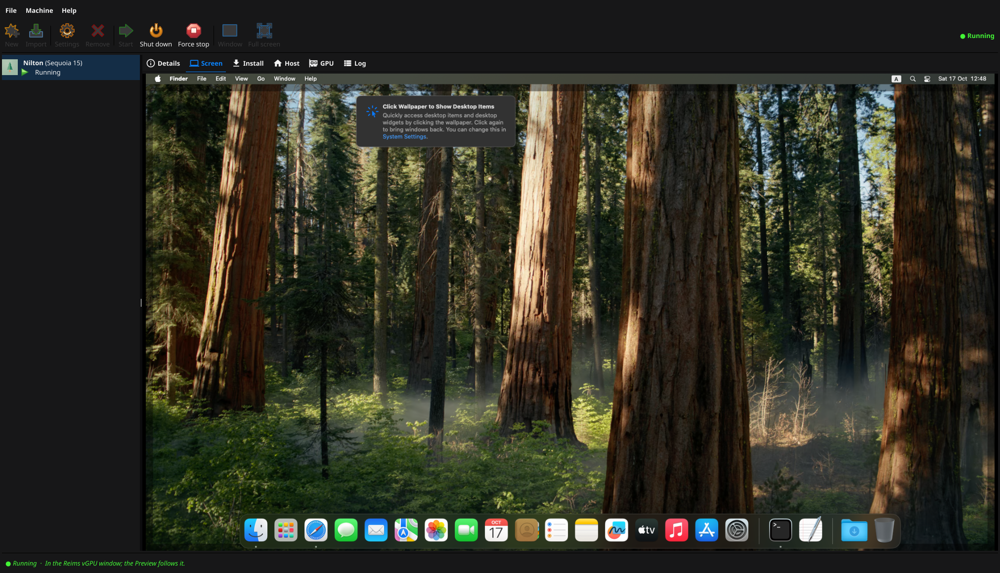

# Reims vGPU

[Documentation index](README.md)

**Experimental.** [Reims vGPU](https://github.com/steelbrain/reims-vgpu) is a paravirtual GPU for macOS guests: macOS uses the paravirtualized graphics driver it already ships, and the host renders its Metal work through the host's own Vulkan driver. It needs no spare GPU, no VFIO and no host reboot, and it works with the GPU that drives your desktop, NVIDIA, AMD or Intel, including cards macOS has no driver for. Upstream is beta and has measured x86-64 guests on macOS 26 only; on this app's reference host, Sequoia 15.8.1 runs on it (see [validated results](#validated-results)).




## Why

| | VMware SVGA (default) | Reims vGPU | [GPU passthrough](gpu-passthrough.md) |
| --- | --- | --- | --- |
| Metal | No: macOS has no driver, it draws on the CPU into a framebuffer | Yes, through the host's Vulkan driver | Yes, on the real card |
| GPU needed | None | The host's own GPU, shared with the desktop | A second, macOS-supported card, reserved for the VM |
| Host changes | None | A separate QEMU build in the Workspace, `vm.max_map_count` | `vfio-pci` reservation and a reboot |
| Screen | In the app or a QEMU window | Reims vGPU's window, inside the Screen tab when the app started the VM on X11 | A monitor on the passed-through card |
| Status | Validated (Sonoma) | Experimental | Untested on real hardware |

Reims vGPU and GPU passthrough are mutually exclusive per VM. Other VMs keep VMware SVGA and the system QEMU.

## Requirements

- **Ubuntu 24.04 or 26.04** for the prebuilt packages and the Docker build. Other distributions can point `reims_qemu` at a build of their own (see [which QEMU runs](#which-qemu-runs)).
- **A Vulkan driver** for the host GPU: `mesa-vulkan-drivers` for AMD and Intel, or the NVIDIA driver. The app looks for an ICD manifest in `/usr/share/vulkan/icd.d` or `/etc/vulkan/icd.d`.
- **`vm.max_map_count` of at least 64 per MiB of guest RAM plus 65536.** Reims vGPU maps guest memory in many small views: a 16 GiB VM needs 1114112, and Ubuntu's default (`/etc/sysctl.d/10-map-count.conf`) is 1048576. **Set up host** in the Host tab (or `macos-kvm-gui setup`) raises it to 2097152, enough for 30 GiB, and keeps it in `/etc/sysctl.d/90-macos-kvm-gui.conf`. By hand:

  ```sh
  sudo sysctl -w vm.max_map_count=2097152
  echo vm.max_map_count=2097152 | sudo tee /etc/sysctl.d/90-macos-kvm-gui.conf
  ```

- **AMD GPUs:** read and write access to `/dev/udmabuf`, through which the library renders on AMD. On Ubuntu the device belongs to the `kvm` group, which **Set up host** already adds you to. The app only warns when it is missing, because QEMU may render on another GPU of the host.
- **Docker**, only to build from source.

## Install

### In short: is it automatic?

| What | Automatic? | How |
|---|---|---|
| **Reims vGPU's QEMU on the host** (needed by every Reims vGPU VM) | **No**: install it once per host | Host tab › **Set up host** (once), then **Install Reims vGPU**; or `macos-kvm-gui reims install` / `reims-gui reims install` |
| Choosing Reims vGPU for a VM | Partly: the New VM wizard picks it for Sequoia and Tahoe **once it is installed** | Settings › Display › Graphics Controller › Reims vGPU, or `config set graphics=reims-vgpu` |
| `ReimsVgpu.kext` (macOS Tahoe guests) | **Yes**: downloaded at the first start and injected by OpenCore | nothing to do |
| `METAL_ERROR_MODE` inside macOS | **No**: once per macOS install | the commands under [First boot in macOS](#first-boot-in-macos) (also shown in Settings › Display) |

Starting a Reims vGPU VM on a host without its QEMU does not download anything: Start stops with *"Reims vGPU is not installed (looked for …): install it in the Host tab or with `macos-kvm-gui reims install`"*. The prebuilt package exists for Ubuntu 24.04 and 26.04. On Debian 13 and Rocky Linux 10, download its package from the `reims-c099dd5` release (or build it as below) and point `reims_qemu` at it. On any release, **Build from source (Docker)** builds the Ubuntu ones.

The app does not embed Reims vGPU. It installs a separate QEMU build into `<Workspace>/.reims/qemu/<build>` and points `<Workspace>/.reims/qemu/current` at it, next to `.kexts` and `.installers`. Nothing else on the host changes.

### Prebuilt package

Click **Install Reims vGPU** in the Host tab, or run:

```sh
macos-kvm-gui reims install
```

The app downloads the package for the host's Ubuntu release from this repository's Releases, from a release of its own tagged `reims-<commit>` (today `reims-c099dd5`), separate from the app's releases. The package is `reims-qemu-<commit>-ubuntu<release>-x86_64.tar.gz` (about 38 MB, upstream's QEMU and its data, stripped); the app checks it against the SHA-256 pinned in its embedded manifest (`internal/core/reims/manifest.json`), unpacks it, refusing absolute paths, `..`, links that leave the folder and anything other than files, folders and links, and activates it.

### Build from source

Click **Build from source** in the Host tab, or run:

```sh
macos-kvm-gui reims build                   # for the host's release
macos-kvm-gui reims build --release 26.04   # for another one: staged, not activated
```

The app builds upstream at the commit it pins with upstream's own `scripts/install-ctl.sh`, inside an `ubuntu:<release>` container from its embedded Dockerfile (`internal/core/reims/Dockerfile`), and strips the binaries. The first build downloads Rust, SDL3, QEMU's source and the Rust crates and took about 10 minutes on the reference host; the cache in `<Workspace>/.reims/build-<release>` makes later builds faster. Progress goes to the terminal or the Log tab. `reims-ctl` and `reims-util` are not built: the app runs QEMU itself.

### Activation

A package and a build are activated the same way: the new build is unpacked beside the others, then run on the host. `current` is switched (atomically) only when its `qemu-system-x86_64` finds every library (`ldd`; missing ones are named with their Ubuntu package), lists the `apple-gfx-pci` device and has its option ROM `share/qemu/ReimsVgpu.rom`. Otherwise `current` stays as it was. A build for another release than the host's stays staged. Older builds of the same release are removed, except one a running VM uses. Installs and builds take a host-wide lock, so two never run at once.

```sh
macos-kvm-gui reims status
```

prints the QEMU a Reims VM runs, its build folder, upstream's commit and whether it lists `apple-gfx-pci`. The Host tab shows the same.

### Which QEMU runs

A VM on Reims vGPU runs the first `qemu-system-x86_64` found here:

1. `reims_qemu` in `settings.yaml` (or the `MKG_REIMS_QEMU` environment variable, which wins), a path to your own build. A relative `reims_qemu` is relative to the folder of `settings.yaml`, a relative `MKG_REIMS_QEMU` to the current directory:

   ```yaml
   reims_qemu: /opt/reims/qemu/bin/qemu-system-x86_64
   ```

2. The app's install, `<Workspace>/.reims/qemu/current/bin/qemu-system-x86_64`.
3. An install by upstream's `install-ctl.sh`, `$XDG_DATA_HOME/reims-ctl/qemu/current/bin/qemu-system-x86_64` (`~/.local/share/...` by default).

The binary must list `apple-gfx-pci` in `-device help`; the app checks it once per binary version.

### Debian 13

An Ubuntu build does not run on Debian (it links Ubuntu's `libjpeg.so.8`), so Debian gets its own build from the same Dockerfile with another base image. Verified on Debian 13.7 (QEMU lists `apple-gfx-pci`, no missing library):

```sh
docker build --build-arg BASE=debian:13 -t reims-build:debian13 - < internal/core/reims/Dockerfile
mkdir -p ~/reims-debian
docker run --rm -e HOST_UID=$(id -u) -e HOST_GID=$(id -g) -v ~/reims-debian:/build reims-build:debian13
sudo apt install libglib2.0-0t64 libpixman-1-0 libslirp0 libfdt1 libgtk-3-0t64 libpipewire-0.3-0t64 libpulse0 libasound2t64 libvulkan1 libgbm1
```

Then point `reims_qemu` at `~/reims-debian/share/reims-ctl/qemu/current/bin/qemu-system-x86_64`. Or skip the build: the [`reims-c099dd5`](https://github.com/jniltinho/macos-kvm-gui/releases/tag/reims-c099dd5) release has `reims-qemu-c099dd5-debian13-x86_64.tar.gz`; unpack it and point `reims_qemu` at its `bin/qemu-system-x86_64`.

### Rocky Linux (RHEL family)

The app does not install or build for Rocky Linux itself, but `Dockerfile.rocky` (next to the Ubuntu `Dockerfile`, in `internal/core/reims/` and `reims-gui/crates/rg-reims/reims/`) builds the same QEMU, at the same commit and with the same layout, on `rockylinux/rockylinux:10`, with the build packages from dnf (EPEL and CRB). Upstream's `install-ctl.sh` only knows apt and pacman; on Rocky it just warns, and the image already has everything. Verified on Rocky Linux 10.2; the first build took about 5.5 minutes on the reference host (image 2.5, QEMU 3):

```sh
docker build --build-arg ROCKY=10 -t reims-build:rocky10 - < internal/core/reims/Dockerfile.rocky
mkdir -p ~/reims-rocky
docker run --rm -e HOST_UID=$(id -u) -e HOST_GID=$(id -g) -v ~/reims-rocky:/build reims-build:rocky10
# optional: reims-qemu-<commit>-rocky10-x86_64.tar.gz and its .sha256
scripts/reims-package.sh pkg "$(readlink -f ~/reims-rocky/share/reims-ctl/qemu/current)" rocky10 dist
```

On the Rocky host, QEMU needs these runtime packages (BaseOS and AppStream only, no EPEL):

```sh
sudo dnf install glib2 pixman libslirp libfdt gtk3 pipewire-libs pulseaudio-libs alsa-lib vulkan-loader mesa-libgbm
```

Then point `reims_qemu` at `~/reims-rocky/share/reims-ctl/qemu/current/bin/qemu-system-x86_64` (see the list above) and check it with `qemu-system-x86_64 -device help | grep apple-gfx-pci`. Or skip the build: [`reims-c099dd5`](https://github.com/jniltinho/macos-kvm-gui/releases/tag/reims-c099dd5) has `reims-qemu-c099dd5-rocky10-x86_64.tar.gz` (built from this Dockerfile and checked in a clean Rocky Linux 10); `.github/workflows/reims-release.yml` builds it for later `reims-<commit>` releases too.

## Turn it on for a VM

- **App:** Settings › Display › **Graphics**: **Reims vGPU (experimental)**. The page shows the `METAL_ERROR_MODE` commands below and, for versions other than macOS 26, that upstream has not measured them. While Reims vGPU is selected the GPU passthrough choice is disabled, and the reverse.
- **New VMs:** the New VM wizard picks Reims vGPU for Sequoia and Tahoe when it is installed; you can change it there or later.
- **Command line:** `macos-kvm-gui config set graphics=reims-vgpu` (back with `graphics=vmware-svga`). `config show` prints it.

Saving refuses a VM with both Reims vGPU and a GPU: `graphics: Reims vGPU and GPU passthrough cannot be used together: choose one of them (clear the GPU, or set graphics to vmware-svga)`. The setting is saved with the VM (database schema 4), and exported and imported with it. Switching back to VMware SVGA boots the same disk as before: OpenCore, NVRAM and the Mac identity do not change.

### Resolution

Reims vGPU's display size is set per VM: Settings › Display › **Resolution** (enabled while Reims vGPU is selected; new VMs get 1920x1080), or `macos-kvm-gui config set resolution=2560x1440`. The choices are `1920x1080` (the default), `1920x1200`, `2048x1152`, `2304x1296`, `2560x1440`, `2560x1600` and `3840x2160`; anything else is refused with that list. It is passed to QEMU as `apple-gfx-pci,...,resolution=<WxH>`, saved with the VM (database schema 5) and exported and imported with it. VMware SVGA ignores it and keeps OpenCore's 1920x1080. The Details pane shows the resolution in use.

**The 2048 px rule.** Upstream (reims-vgpu `docs/qemu.md`): without ReimsVgpu.kext, WindowServer dies at boot often enough to matter on displays wider than 2048 px (the display is drawn in 1024 px tiles), and the kext loads on macOS 26 only. Measured on Sequoia (table below), 3840x2160 is the exception: macOS drives it as a HiDPI desktop and WindowServer did not crash. So the Settings page and `config set` warn for 2304x1296, 2560x1440 and 2560x1600 unless the VM is Tahoe. If WindowServer crashes, set the resolution back to 1920x1080.

Measured on the reference host (Sequoia 15.8.1, RTX 4070, no kext):

| Resolution | Result | Preview frame read (VNC) |
| --- | --- | --- |
| 1920x1080 | Login window and desktop, no crash | 0.42 s |
| 1920x1200 | Login window, no crash | 0.46 s |
| 2304x1296 | WindowServer crashed at login (1 of 1 boots) | — |
| 2560x1440 | WindowServer crashed at login (3 of 3 boots) | 0.79 s |
| 3840x2160 | Login and desktop with no crash (3 of 3 boots); macOS picks a HiDPI desktop that looks like 1920x1080 | 1.0–1.8 s |

So before macOS 26 the app warns for widths between 2048 and 3840 px (2304x1296, 2560x1440, 2560x1600); 4K is the way to a sharper desktop there. On Tahoe, ReimsVgpu.kext (below) is meant to cover them.

The Preview's refresh follows the size: no faster than about twice a frame read (0.2 s minimum), so a 4K VM's Preview updates every few seconds without keeping QEMU busy.

### ReimsVgpu.kext on Tahoe

A Tahoe VM on Reims vGPU loads upstream's ReimsVgpu.kext ([steelbrain/reims-util](https://github.com/steelbrain/reims-util/tree/b302389a957c56fad8e5b3b3b16107932ea9e5e9/kext), commit `b302389`), which macOS 26 needs for displays wider than 2048 px. The app does not ship it: before such a VM starts (from the app, `vm start` or the MCP server's `vm_start`), it downloads `Contents/Info.plist` and `Contents/MacOS/ReimsVgpu` over HTTPS from that commit, checks each file's pinned SHA-256 and keeps it in `<Workspace>/.kexts/reims-util-b302389/ReimsVgpu.kext`; a file that does not match stops the start and caches nothing. Creating a VM stays offline. OpenCore gets it after Lilu (it is a Lilu 1.7.2 plugin, the version the app embeds) and the other built-in kexts, before any [extra kexts](architecture.md#extra-kexts), with `MinKernel` 25.0.0. Other versions and VMware SVGA VMs never load it, and `settings.yaml` cannot list another kext named ReimsVgpu. Upstream's off switch is the boot argument `-reimsvgpuoff`; the app writes OpenCore's `boot-args` at every start and has no setting for it yet, so it is mainly useful when debugging upstream's kext.

## First boot in macOS

macOS needs `METAL_ERROR_MODE` set to 5 once, or the desktop never appears on Reims vGPU.

**A VM that already has a desktop:** set it before switching, in the guest's Terminal (or over SSH), then shut down and switch to Reims vGPU:

```sh
sudo defaults write /Library/Preferences/.GlobalPreferences METAL_ERROR_MODE -int 5
```

**A new install:** after macOS is installed, boot the recovery (hold **Esc** at boot for OpenCore's picker, or keep the install media) and in **Utilities › Terminal** run:

```sh
cd /Volumes/*Data/Library/Preferences
defaults write "$PWD/.GlobalPreferences" METAL_ERROR_MODE -int 5
chmod 644 .GlobalPreferences.plist
reboot
```

The installer and the recovery themselves boot on Reims vGPU without it: they draw into `apple-gfx-pci`'s EFI framebuffer (BAR 2), without Metal.

To check it, run `system_profiler SPDisplaysDataType` in the guest: it shows **Apple Paravirtualized Graphics Device** with Metal support.

## The screen

A Reims VM's screen is Reims vGPU's own accelerated window, opened by the library through SDL3 and Vulkan, whatever the VM's Display setting.

**Inside the Screen tab.** When the app starts the VM and its window is on X11 (directly, or through XWayland on a Wayland desktop), that window is moved into the **Screen** tab, the way [reims-gui](reims-gui.md) does it, with the same code (`reims-gui/crates/rg-x11` through a C ABI; see [development](development.md#embedding-reims-vgpus-window)):
- It opens on the desktop for an instant and then joins the tab.
- It follows the tab when the app window moves or resizes, at any HiDPI scale.
- It hides while a dialog or a menu is open over it, or another tab is selected.
- Click it to type in macOS; Ctrl+Alt+Super releases the capture, and a click on the app's own controls gives them the keyboard back.
- On SIGTERM, SIGINT or SIGHUP the app puts the window back on the desktop before it exits. QEMU still stops with the app.



**In its own window** otherwise. The window stays on the desktop and keyboard and mouse go there when:
- the VM was started by `vm start` or the MCP server;
- the window could not be found within 30 seconds (the Log tab says why);
- there is no X server;
- the app was built without embedding (plain `go build`, without `-tags reims_embed`).

Either way the app still serves its private VNC socket, so:

- the **Preview** in Details keeps updating;
- when the window is not embedded, the **Screen** tab does not attach; it says that the screen is in the Reims vGPU window;
- the [MCP server](mcp.md)'s `screen_capture`, `send_keys`, `type_text` and `pointer` keep working, for VMs started by the app, by `vm start` or by the MCP server.

VNC is not used as the screen because reading frames from the paravirtual GPU through QEMU's console is slow (upstream measured about 1.7 s per 1080p frame), fine for a preview but not to work in.

## What changes in QEMU's command line

Only where upstream's measured x86-64 command differs; disks, network adapters, the CPU profile, SMC, OpenCore and QMP are as for any VM.

| VMware SVGA | Reims vGPU | Why |
| --- | --- | --- |
| `qemu-system-x86_64` from `PATH` | The Reims QEMU ([which QEMU runs](#which-qemu-runs)), with `REIMS_VGPU_WINDOW` removed from its environment | The device exists only in Reims's QEMU fork; the variable would hide the window |
| `-device vmware-svga` | `-device apple-gfx-pci,id=gfx,displays=1,resolution=<WxH>` (1920x1080 by default, see [resolution](#resolution)), no fixed PCI address | Upstream's `addr=0x4` is taken by the app's `ich9-ahci`; OpenCore boots by scanning |
| `-machine q35` | `-machine q35,memory-backend=ram -object memory-backend-memfd,id=ram,size=<RAM>M,share=on` | The library maps guest RAM |
| (none) | `-global ICH9-LPC.disable_s3=1 -vga none` | No ACPI S3; no default VGA |
| `-device qemu-xhci,id=xhci` | `...,conditional-intr-mapping=on` | macOS's xHCI driver |
| `-device hda-duplex` | `hda-duplex,audiodev=snd0`, `-audiodev <pipewire\|pa\|none>,id=snd0`, `-device usb-audio,audiodev=snd0,bus=xhci.0` | macOS 26 has no Intel HDA driver; HDA stays for OpenCore's chime |
| `-display none -vnc unix:...` only with Display: In the app | Always `-display none -vnc unix:...` | The window is the library's; VNC serves the Preview and MCP |

The audio backend is PipeWire when its socket is in `$XDG_RUNTIME_DIR`, then PulseAudio, then `none`. The Log tab shows the full command at every start.

## Limits and known issues

- **Wide displays before macOS 26.** Between 2048 and 3840 pixels wide, WindowServer crashed at every login on Sequoia without ReimsVgpu.kext, which loads on macOS 26 only; 3840x2160 works as a HiDPI desktop ([resolution](#resolution)). No multiple displays or `resolution=host`.
- **Measured upstream on macOS 26 only.** Other versions are offered with a note; this app's reference host validated Sequoia 15.8.1.
- **Sleep** is reduced to a dark wake: S3 is off.
- **AMD GPUs** need `/dev/udmabuf` (see [requirements](#requirements)).
- **Ubuntu 24.04 and 26.04 only** for packages and builds; x86-64 hosts only.
- **Upstream is beta** and changes fast; the app pins one commit and updates it with its own releases.
- `usb-audio` and `conditional-intr-mapping` follow upstream's macOS 26 command and are unmeasured on earlier versions.

Errors and fixes are in [troubleshooting](troubleshooting.md#reims-vgpu).

## Validated results

Reference host: Ubuntu 24.04, Ryzen 9 9900X, an RTX 4070 driving the desktop and an RX 6700 XT.

| Item | Result |
| --- | --- |
| Build | Upstream commit `c099dd5`, QEMU 11.1.50, built in Docker in about 10 minutes |
| Package | `reims-qemu-c099dd5-ubuntu24.04-x86_64.tar.gz`, about 38 MB (26.04: about 38 MB); source archive about 95 MB |
| Guest | macOS Sequoia 15.8.1, 16 GiB of RAM, `METAL_ERROR_MODE` 5 |
| `system_profiler SPDisplaysDataType` | Apple Paravirtualized Graphics Device, Vendor Apple (0x106b), Device ID 0xeeee, Metal Support: Metal 2; display Reims vGPU 1920 x 1080 @ 75 Hz |
| Switching back to VMware SVGA | Boots as before |

## Licensing

Reims vGPU is not part of the app's packages or source. The library is GPL-2.0-or-later OR LGPL-3.0-or-later; it is linked statically into a QEMU fork under GPL-2.0, with SDL3 (zlib) and Rust crates under their own licenses. The `reims-<commit>` release that holds the packages also holds their corresponding source, `reims-vgpu-src-<commit>.tar.gz` (upstream at that commit, QEMU's source, the vendored Rust crates, the license texts and the Dockerfile the packages were built with). Details are in the [third-party notices](../THIRD_PARTY_NOTICES.md).

## Credits

Reims vGPU is the work of [steelbrain/reims-vgpu](https://github.com/steelbrain/reims-vgpu) and its contributors: the library, the `apple-gfx-pci` device in its QEMU fork, the measured command line this app follows, and `reims-ctl`/`reims-util`, upstream's own VM runner and OpenCore tools, which this app does not use. Bugs in the app's integration belong here; bugs in rendering belong upstream. See [references](references.md#reims-vgpu).
