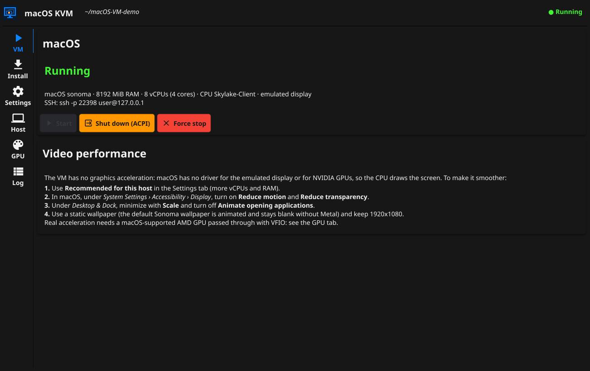

# Screenshots

Screens of macOS KVM with the default dark theme. They were captured on the reference host (Ubuntu 24.04, Ryzen 9 9900X, QEMU 8.2.2). Back to the [documentation](../README.md).

## VM



The VM tab while a VM is running: the state shows in large text and in the header chip, ACPI shutdown and force stop are enabled, and the CPU, RAM, display and SSH settings are summarized. Below it are the tips for keeping video smooth without GPU acceleration.

## Install


The guided install. **1 · Workspace** extracts the built-in OpenCore and OVMF. **2 · macOS recovery** downloads from Apple and verifies the signature. **3 · Disk** creates the thin qcow2. **4 · Install inside the VM** lists the steps to follow in macOS. **5 · Clean up** removes the install media. The status card shows the boot file versions and their source.

## Settings


The workspace, macOS version, RAM, cores, vCPUs and SSH port. **Recommended for this host** fills in CPU and RAM from the host's hardware.

## Host


The host checks, each colored OK, Warning, Failure or Inconclusive. **Set up host** fixes the basics with one password prompt: missing QEMU packages, the KVM module, the kvm group and ignore_msrs. The home lab notice sits below.

## GPU


Every display adapter on the host, with its macOS compatibility, IOMMU group, driver and the reason it can or cannot be passed to the VM. On this host none is eligible: NVIDIA cards and the Ryzen iGPU have no macOS driver. See [GPU passthrough](../gpu-passthrough.md).

## Log


The QEMU command line and output, together with the app's own messages (last 1000 lines).

## Updating these screenshots

Build with `make build`, run `./dist/macos-kvm-gui`, resize the window to 1280x820 and capture each tab. On X11, for example:

```sh
WID=$(xdotool search --name '^macOS KVM' | head -1)
xdotool windowsize --sync "$WID" 1280 820
import -window "$WID" docs/screenshots/<tab>.png
```

Keep personal paths and data out of the captures: use a short workspace path such as `~/OSX-KVM`, and a throwaway workspace for the running-VM shot.
