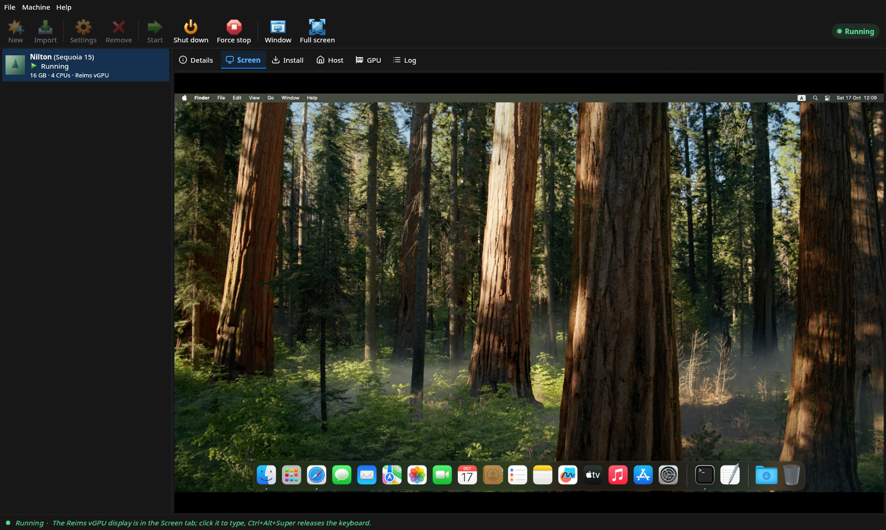
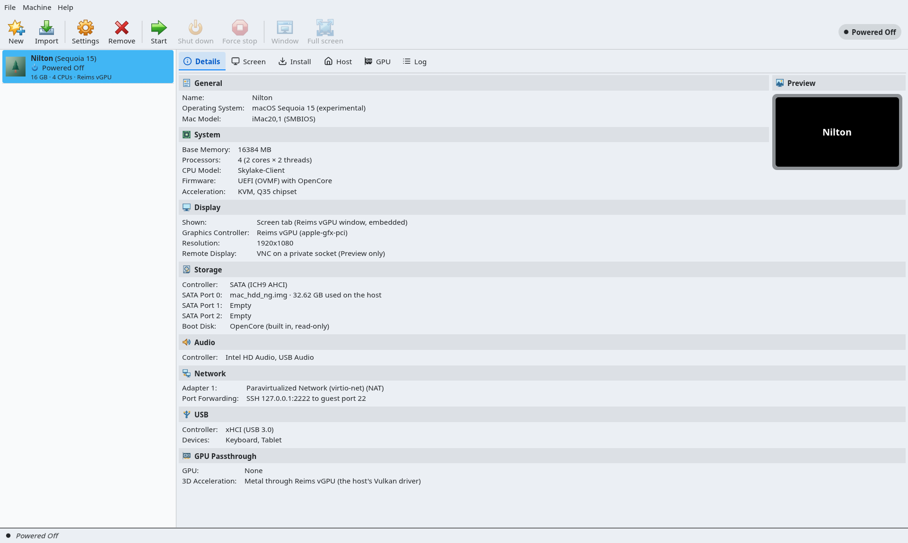
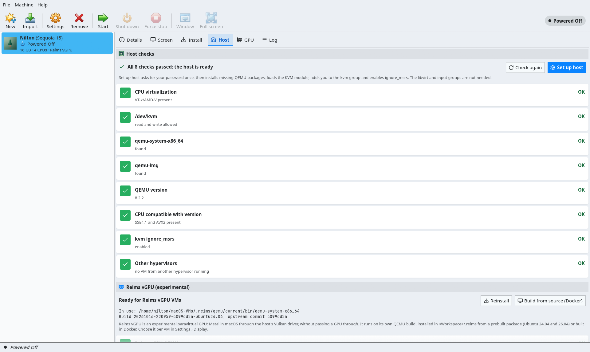

# reims-gui

`reims-gui` installs and runs macOS virtual machines on QEMU/KVM, with
[Reims vGPU](../docs/reims-vgpu.md) first: macOS's Metal rendered by the host's own GPU, and the
guest display shown **inside the app's window**. It is the Rust rewrite of
[macos-kvm-gui](../README.md) (Go/Fyne): the same features, the same data, the GUI, the command
line and the MCP server in one binary. It targets **Ubuntu 24.04 and 26.04** on x86-64.

**For home lab use.** Check [Apple's macOS license terms](https://www.apple.com/legal/sla/). This
project is not affiliated with Apple. `reims-gui` is new: what it does and does not do yet is
tracked item by item in [PARITY.md](PARITY.md).

User guide: [docs/reims-gui.md](../docs/reims-gui.md).

## Screenshots





More in [docs/screenshots](../docs/screenshots/README.md).

## Features

- **Reims vGPU inside the window.** QEMU's Reims vGPU window is embedded in the Screen tab over
  X11 (or XWayland on a Wayland desktop): the GPU draws the guest as fast as in its own window,
  and keyboard and pointer go straight to it. Without X11 the window stays on its own.
- **Reims-first.** New Sequoia and Tahoe VMs use Reims vGPU when the host can run it; the Host tab
  installs the prebuilt Reims QEMU package or builds it in Docker.
- **Everything the Go app does.** Recovery download with Apple's signature and per-chunk checks,
  full installers and the offline install disc, thin qcow2 disks, up to four network adapters
  (NAT or bridged), GPU passthrough with VFIO reservation, root-patch mode, extra kexts from
  `settings.yaml`, host checks and one-prompt host setup, export/import/move, light, dark and
  system themes.
- **VirtualBox-style GUI.** File/Machine/Help menus, toolbar, VM list, Details, Screen, Install,
  Host, GPU and Log tabs, Settings, the New VM wizard and Preferences.
- **Scriptable.** The same binary is a command line tool and an MCP server for AI agents.
- **Built in Docker.** One script builds the `.deb` and `.tar.gz` for each Ubuntu release; the
  host needs only Docker.

## Install

Download from the project's [GitHub Releases](https://github.com/jniltinho/macos-kvm-gui/releases)
(tags `reims-gui-v*`) the package, one for Ubuntu 24.04 and 26.04, and check it against its `.sha256`:

```sh
sha256sum -c reims-gui_0.1.4_amd64.deb.sha256
sudo apt install ./reims-gui_0.1.4_amd64.deb
```

The `.deb` pulls in `qemu-system-x86`, `qemu-system-gui` (QEMU's GTK window, embedded for VMware SVGA), `qemu-utils` and the X11, Wayland, Vulkan and OpenGL
libraries the window needs, and adds `reims-gui` to the app grid.

Or the `.tar.gz`, which holds the binary, the license texts and notices, a short README and the
desktop entry:

```sh
tar xf reims-gui-0.1.4-x86_64.tar.gz
sudo apt install qemu-system-x86 qemu-system-gui qemu-utils
./reims-gui-0.1.4-x86_64/reims-gui
```

The package is built against Ubuntu 24.04's libraries, the older of the two, so the same files install and run on 26.04 (the release checks run both).

## First run

1. Open **reims-gui**, go to the **Host** tab and click **Set up host**. It asks for your password
   once, installs missing QEMU packages, loads KVM, adds you to the `kvm` group, enables
   `ignore_msrs` and raises `vm.max_map_count` for Reims vGPU. Log out and in if it added you to
   the group.
2. In the same tab click **Install Reims vGPU** (the prebuilt QEMU for your release, into
   `<Workspace>/.reims`) or **Build from source (Docker)**. Then **Check again**: every row should
   be OK.
3. **New** creates a VM: Sequoia and Tahoe get Reims vGPU by default. The **Install** tab walks
   through the folder, the recovery, the disk and the install; **Start** shows macOS in the
   **Screen** tab.

More in the [user guide](../docs/reims-gui.md) and, for Reims vGPU itself, in
[docs/reims-vgpu.md](../docs/reims-vgpu.md).

## Command line and MCP

The commands, flags and output are the Go app's, with `reims-gui` as the name. See
[docs/cli.md](../docs/cli.md).

```sh
reims-gui check                      # can this host run macOS on KVM?
reims-gui vm list
reims-gui vm create lab --version sequoia
reims-gui download                   # recovery for the selected VM
reims-gui disk create --size 80
reims-gui vm start                   # Ctrl+C presses the power button, twice kills QEMU
reims-gui reims status
```

`reims-gui mcp` is the [MCP server](../docs/mcp.md) (stdio): an AI agent can list, start and stop
VMs, see the screen, type, click and install macOS offline. Register it once:

```sh
claude mcp add reims-gui -- reims-gui mcp     # Claude Code
codex mcp add reims-gui -- reims-gui mcp      # Codex
```

## Build from source

Only Docker is needed on the host; nothing else is installed. From `reims-gui/`:

```sh
scripts/cargo-docker.sh cargo test --workspace     # tests in the Ubuntu 24.04 image
scripts/cargo-docker.sh 26.04 cargo build          # any cargo command, in the 26.04 image
scripts/build.sh                                   # release build and packages, in the 24.04 image
scripts/check-package.sh 24.04                     # install the .deb in a clean container, run --self-test under Xvfb
scripts/check-package.sh 26.04                     # the same package on 26.04
scripts/check-gnome.sh 24.04                       # the .deb under Mutter (Wayland + XWayland): self-tests, SVGA embed
scripts/check-gnome.sh 26.04
```

`build.sh` leaves in `dist/` `reims-gui-<version>-x86_64.tar.gz`, `reims-gui_<version>_amd64.deb`
and their `.sha256` files. The first run builds the
`reims-gui-build:<release>` image (`docker/Dockerfile`, pinned Rust toolchain).
`scripts/source-archive.sh` writes `dist/reims-gui-<version>-source.tar.gz`, the corresponding
source of a release with the vendored crates.

`cargo run -p rg-ui --example demo` (through `cargo-docker.sh`, or `reims-gui --demo`) opens the
GUI on fake data.

The workspace is split into crates (`crates/rg-*`), each with an `API.md`: `rg-core` (types,
SQLite registry, settings, workspace), `rg-assets` (OpenCore, OVMF, kexts), `rg-host` (checks,
setup, GPUs), `rg-macos` (recovery, installers), `rg-qemu` (arguments, process, QMP, VNC),
`rg-reims` (Reims packages), `rg-x11` (window embedding), `rg-ops` (orchestration), `rg-ui` (the
egui app), `rg-agent` (CLI and MCP) and `apps/reims-gui` (the binary).

## Relationship with the Go app

`reims-gui` reads and writes the Go app's data unchanged: the VM list in
`~/.config/macos-kvm-gui/macos-kvm-gui.db`, `settings.yaml` and the Workspace
(`<Workspace>/<vm>`, `.kexts`, `.installers`, `.reims`). Both can be installed and run at the same
time: each sees the VMs the other started, can shut them down through their control socket and
refuses to start a VM that is already running. You can switch back at any time. The Go app stays
until every item of [PARITY.md](PARITY.md) is checked.

## License

- The `reims-gui` source is **GPL-2.0-or-later OR LGPL-3.0-or-later** ([LICENSE](LICENSE)), the
  terms of Reims vGPU's reims-ctl it starts from. The Go app stays BSD-3-Clause.
- The **binaries are distributed under GPL-3.0-or-later**
  ([LICENSES/GPL-3.0-or-later.txt](LICENSES/GPL-3.0-or-later.txt)), because they link
  Apache-2.0-only crates, which GPL-2.0 does not allow.
- [THIRD_PARTY_NOTICES.md](THIRD_PARTY_NOTICES.md): code adapted from reims-vgpu, rustXterm and
  PhotoCraft, fonts and icons, with their licenses. [LICENSES/](LICENSES) holds the license texts.
- Packages also carry `THIRD_PARTY_LICENSES`, the license of every Rust crate compiled in, and each
  release has its source archive (vendored crates and the build Dockerfile included).
